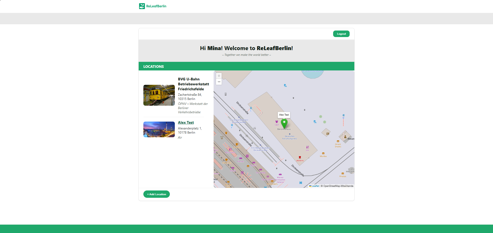
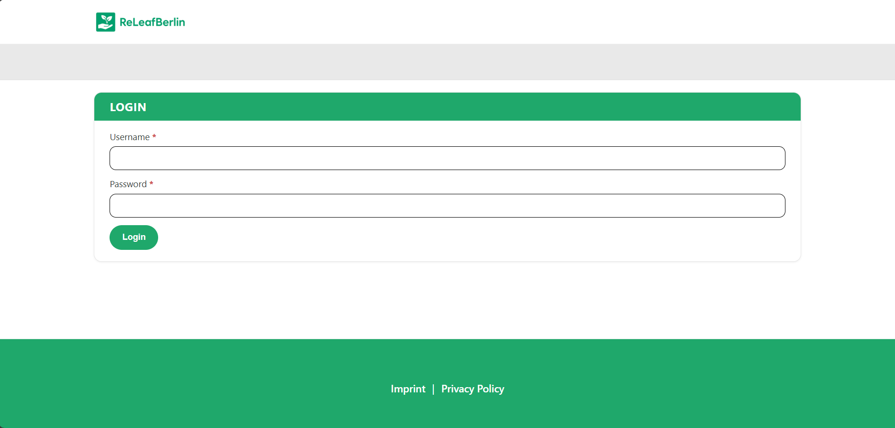
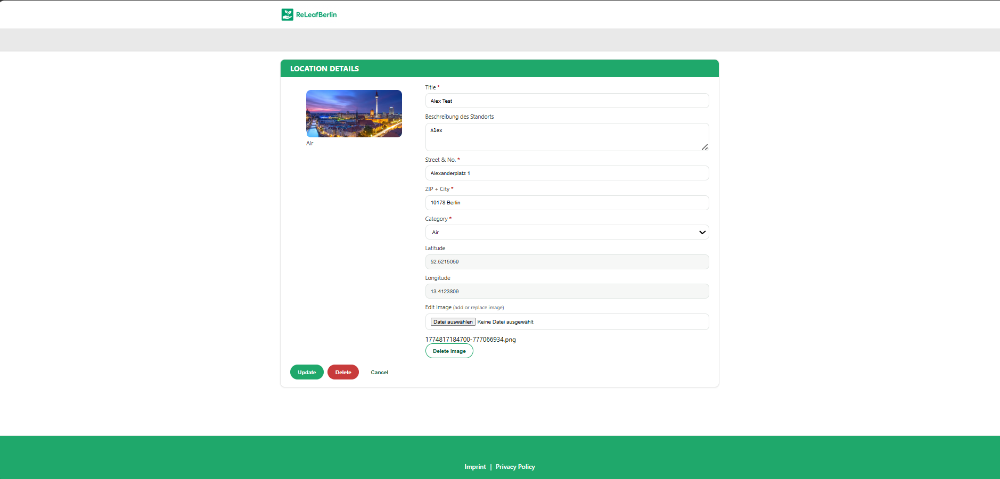

# 🌱 ReLeafBerlin

A full-stack web application for managing and visualizing sustainable and non-sustainable locations in Berlin.

This project was developed as part of the **Web Application Development (WAD)** course at HTW Berlin.

---

## Overview

ReLeafBerlin is a Single Page Application (SPA) that allows users to explore, manage, and visualize environmental locations on an interactive map.

The application distinguishes between user roles in the user interface and provides full CRUD functionality for location management.

---

## Features

* Login with role-based user interface (Admin / User)
* Interactive map integration (Leaflet + OpenStreetMap)
* Location management (Create, Read, Update, Delete)
* Image upload and display for locations
* Dynamic list synchronized with map markers
* Marker highlighting & detail view
* Address geocoding via server-side proxy (Nominatim)

---

## Tech Stack

**Frontend**

* Vanilla JavaScript (SPA)
* HTML5 / CSS3

**Backend**

* Node.js
* Express.js (REST API)
* Multer (image upload)

**Database**

* MongoDB

**Map & Geocoding**

* OpenStreetMap
* Leaflet
* Nominatim (Geocoding)

---

## Architecture (Simplified)

Client (SPA)
⬇️
REST API (Express)
⬇️
MongoDB Database

* Frontend communicates via REST endpoints
* Backend handles data access, image upload & geocoding
* Images are stored on the server (not in the DB), the DB only stores the image path

---

## Screenshots

### Main Screen


### Login Screen


### Add Location Screen


### Location Details Screen


---

## API (Overview)

| Method | Endpoint       | Description              |
|--------|----------------|--------------------------|
| POST   | `/users/login` | Log in a user            |
| GET    | `/loc`         | Get all locations        |
| GET    | `/loc/:id`     | Get one location         |
| POST   | `/loc`         | Create new location      |
| PUT    | `/loc/:id`     | Update location          |
| DELETE | `/loc/:id`     | Delete location          |
| GET    | `/geocode`     | Get coordinates for an address (`street`, `zipCity`) |

---

## Installation & Run

1. Clone the repository:

```bash
git clone https://github.com/ahm-ud/ReleafBerlin.git
cd ReleafBerlin
```

2. Install dependencies:

```bash
npm install
```

3. Start the server:

```bash
npm start
```

4. Open in browser: http://localhost:8000

> Note: The MongoDB server is hosted at HTW Berlin. Access from outside the university network may require the HTW VPN.

---

## Author

**Ahmed Al-Odaini**
B.Sc. Applied Computer Science – HTW Berlin

---

## Notes

* This project was developed for educational purposes
* Focus: Full-stack development, REST APIs, and interactive UI
